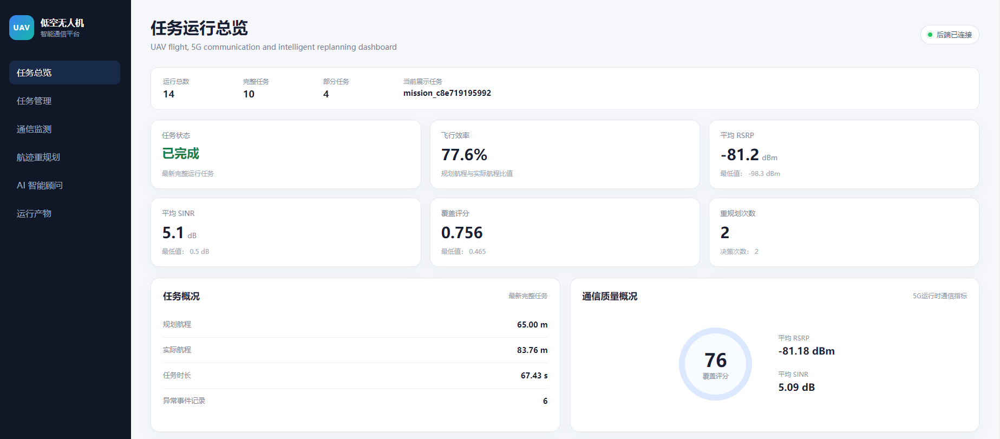
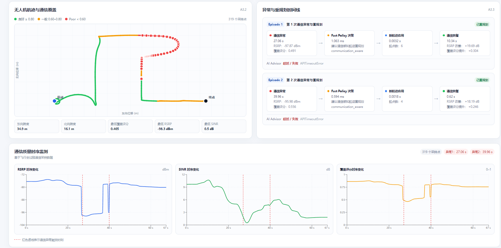
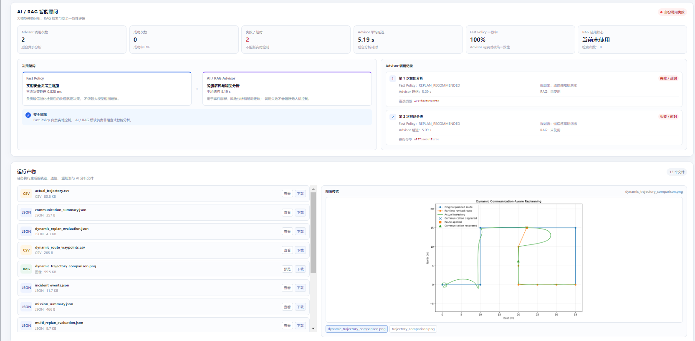
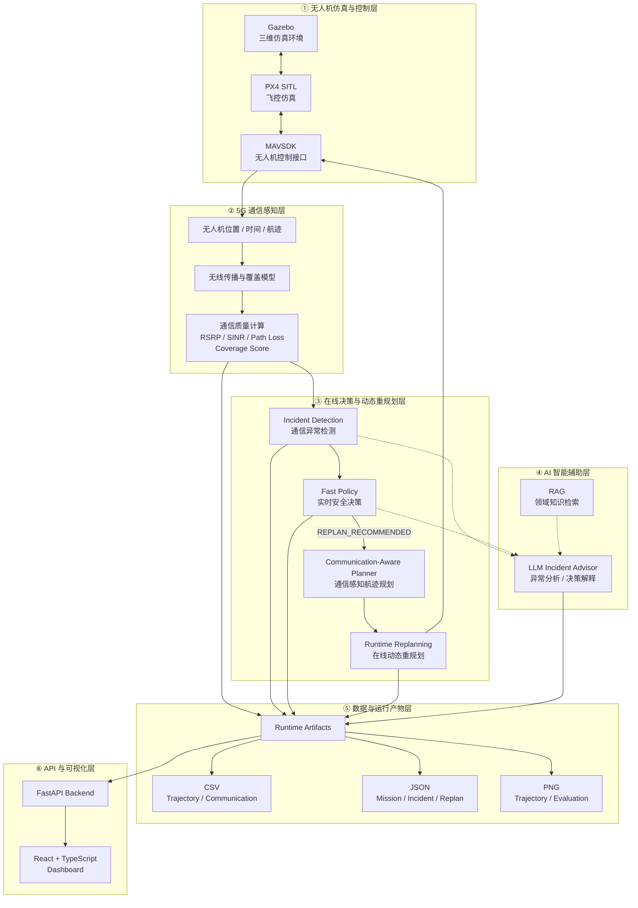

# 面向低空无人机的 5G 通信感知航迹优化与智能决策平台

> Low-Altitude UAV 5G Communication-Aware Path Planning & Intelligent Decision Platform

<!-- README_VISUAL_HERO -->

<p align="center">
  
  
  
  
  
  
  
  
</p>

<p align="center">
面向低空无人机复杂无线环境，融合
<b>5G 通信感知、在线航迹重规划、实时安全决策与 AI / RAG 智能分析</b>
的端到端实验与可视化平台。
</p>

### 核心能力

| 通信感知 | 实时决策 | 动态重规划 | AI 智能分析 | 可视化平台 |
| --- | --- | --- | --- | --- |
| RSRP / SINR / Coverage | Fast Policy | Multi-Replanning | LLM + RAG Sidecar | FastAPI + React |
| 飞行过程持续评估 | ≈ 0.83 ms | 单任务多次重规划 | 非阻塞辅助链路 | Runtime Artifacts |

### V0.9 Demo 指标

| 指标 | 当前结果 |
| --- | ---: |
| 历史运行任务 | 14 |
| 完整任务 | 10 |
| 当前航迹采样点 | 319 |
| 动态重规划次数 | 2 |
| Flight Efficiency | 77.6% |
| Mean RSRP | -81.18 dBm |
| Mean SINR | 5.09 dB |
| Mean Coverage Score | 0.756 |
| Fast Policy 平均决策延迟 | ≈ 0.83 ms |

## Dashboard Preview

### 任务运行总览

<p align="center">
  
</p>

### 通信质量监测与动态重规划

<p align="center">
  
</p>

### AI / RAG 智能顾问与运行产物

<p align="center">
  
</p>

> **核心架构原则：** Fast Policy 负责毫秒级实时安全决策；AI / RAG Advisor 作为非阻塞 Sidecar 负责异常解释、知识检索与辅助分析。即使 Advisor 超时，也不会阻塞无人机飞行控制和动态重规划。

---


## 项目简介

本项目面向低空无人机复杂无线环境下的通信保障与自主飞行问题，构建从 **无人机仿真、5G 通信感知、异常检测、实时决策、动态航迹重规划到 AI / RAG 辅助分析与 Web 可视化** 的端到端实验平台。

平台以 **PX4 SITL + Gazebo + MAVSDK** 构建无人机运行环境，以 **Fast Policy + Communication-Aware Planner** 完成通信异常后的实时重规划，并通过 **FastAPI + React** 将任务、通信、重规划和 AI 分析结果统一展示。

当前版本：**V0.9**

---

## 1. 项目目标

传统无人机航迹规划通常更加关注飞行距离、飞行时间和障碍物避让，而在低空复杂环境中，建筑遮挡、多径传播以及无线覆盖不均可能导致明显的通信质量下降。

本项目重点解决以下问题：

1. 无人机飞行过程中如何持续评估 5G 通信质量；
2. 如何检测 RSRP、SINR 和 Coverage Score 等指标异常；
3. 如何根据通信状态动态调整无人机飞行航迹；
4. 如何实现飞行过程中的多次在线动态重规划；
5. 如何在保证实时性的同时引入大模型与 RAG 辅助分析；
6. 如何将无人机飞行、通信状态、异常事件和重规划全过程进行可视化展示。

---

## 2. 核心架构思想

平台采用“**实时控制主链路 + AI 智能辅助链路**”的设计方式。

### 实时控制主链路

```text
无人机飞行
    ↓
5G 通信质量计算
    ↓
通信异常检测
    ↓
Fast Policy
    ↓
Communication-Aware Planner
    ↓
Runtime Replanning
    ↓
MAVSDK 更新航迹

```

Fast Policy 负责毫秒级实时决策，不依赖大模型在线响应。

### AI 智能辅助链路

```text
Incident Event
    ↓
Fast Policy Decision
    ↓
RAG Knowledge Retrieval
    ↓
LLM Incident Advisor
    ↓
异常解释 / 决策分析 / 辅助建议
```

AI / RAG Advisor 采用非阻塞 Sidecar 方式运行，即使出现超时或调用失败，也不会影响无人机实时飞行控制和动态重规划。

---

## 3. 系统架构

平台整体采用分层设计，将无人机仿真、无线通信计算、实时决策、AI 智能分析、运行产物以及 Web 可视化进行解耦。



### 3.1 无人机仿真与控制层

以 **Gazebo + PX4 SITL + MAVSDK** 构建无人机运行环境。

Gazebo 提供三维仿真环境，PX4 SITL 完成飞控逻辑仿真，MAVSDK 负责上层任务控制、航点下发以及运行状态获取。

### 3.2 5G 通信感知层

根据无人机实时位置和飞行轨迹计算通信质量，并生成：

- RSRP；
- SINR；
- Path Loss；
- Coverage Score；
- Serving BS；
- Coverage Level。

这些通信指标作为异常检测和通信感知航迹规划的基础输入。

### 3.3 在线决策与动态重规划层

当通信质量下降时，Incident Detection 首先识别通信异常。

随后由 **Fast Policy** 判断是否需要重规划。当决策为 `REPLAN_RECOMMENDED` 时，调用 Communication-Aware Planner 生成新的航迹，并通过 MAVSDK 应用到无人机任务中。

### 3.4 AI 智能辅助层

AI / RAG Advisor 与实时控制链路解耦，主要承担：

- 通信异常解释；
- Fast Policy 决策分析；
- RAG 领域知识检索；
- 规划建议生成；
- 任务结果辅助分析。

该链路不直接参与无人机实时控制，因此 AI 调用超时不会阻塞飞行任务。

### 3.5 数据与运行产物层

系统将实验全过程保存为 Runtime Artifacts，包括：

- CSV 飞行与通信数据；
- JSON 任务、异常和重规划记录；
- PNG 航迹与评估结果图。

这些产物既用于实验复现，也作为 Dashboard 的数据源。

### 3.6 API 与可视化层

FastAPI 对 Runtime Artifacts 进行统一解析并提供 REST API。

React + TypeScript Dashboard 通过 API 展示：

- 任务运行状态；
- 无人机飞行航迹；
- 5G 通信质量；
- 通信异常事件；
- 动态重规划过程；
- AI / RAG Advisor 状态；
- 实验运行产物。

---

## 4. 核心功能

### 4.1 无人机仿真与任务控制

基于 **PX4 SITL + Gazebo + MAVSDK** 构建无人机仿真与控制环境，实现：

- 无人机起飞与降落；
- 航点任务执行；
- 实时位置与飞行状态获取；
- 动态航点更新；
- 通信感知航迹执行；
- 重规划后新航迹在线应用。

### 4.2 5G 通信质量评估

飞行过程中同步计算并记录：

- Path Loss；
- RSRP；
- SINR；
- Coverage Score；
- Serving BS；
- Coverage Level。

通信数据与无人机位置、飞行时间和航迹信息同步保存，用于后续异常检测、重规划和结果分析。

### 4.3 通信异常检测

系统持续监测飞行过程中的通信质量。

当 RSRP、SINR 或 Coverage Score 出现明显退化时，生成 Incident Event，并记录异常发生时刻、无人机位置以及对应通信指标。

### 4.4 Fast Policy 实时决策

通信异常发生后，由确定性的 Fast Policy 完成实时决策。

当前支持的主要决策包括：

```text
KEEP_ROUTE
REPLAN_RECOMMENDED
```

Fast Policy 不依赖在线 LLM 推理，能够保证实时控制链路的低延迟和确定性。

### 4.5 通信感知动态重规划

当决策结果为 `REPLAN_RECOMMENDED` 时，系统调用 Communication-Aware Planner 生成新航迹。

完整执行链路为：

```text
通信质量下降
    ↓
Incident Detection
    ↓
Fast Policy
    ↓
REPLAN_RECOMMENDED
    ↓
Communication-Aware Planner
    ↓
新航迹生成
    ↓
MAVSDK 应用新航点
    ↓
无人机继续飞行
    ↓
通信质量恢复
```

平台支持一次任务中的多次 Runtime Replanning。

### 4.6 AI / RAG Incident Advisor

平台在实时控制主链路之外设计独立的 AI Advisor Sidecar，用于：

- 通信异常解释；
- Fast Policy 决策分析；
- RAG 领域知识检索；
- 规划方案辅助分析；
- 任务运行结果解释。

AI Advisor 不直接阻塞无人机实时控制。

### 4.7 Runtime Artifacts

每次任务自动保存结构化运行产物，包括：

- 飞行轨迹 CSV；
- 通信指标 CSV；
- Incident JSON；
- Replan JSON；
- Mission Summary；
- AI / RAG Evaluation；
- 航迹对比 PNG。

所有运行产物都可以通过后端 API 和 Dashboard 进行读取。

---

## 5. Web Dashboard

V0.9 基于 **FastAPI + React + TypeScript** 实现任务运行结果可视化。

Dashboard 当前包含以下主要模块。

### 5.1 任务运行总览

展示：

- 历史运行任务数量；
- COMPLETE / PARTIAL 状态；
- 飞行距离；
- 飞行时长；
- 飞行效率；
- 通信质量指标；
- Incident 数量；
- 动态重规划次数。

### 5.2 无人机航迹与通信覆盖

根据实际飞行轨迹绘制二维航迹，并通过 Coverage Score 对轨迹进行分级展示。

支持显示：

- 起点；
- 终点；
- 良好覆盖区；
- 一般覆盖区；
- 弱覆盖区；
- 最低 RSRP；
- 最低 SINR；
- 最低 Coverage Score。

### 5.3 通信异常与重规划时间线

按照 Episode 展示：

```text
通信异常
→ Fast Policy 决策
→ 新航迹应用
→ 通信恢复
```

能够直观观察每次重规划的触发原因和恢复效果。

### 5.4 通信质量时序监测

基于 Recharts 绘制：

- RSRP；
- SINR；
- Coverage Score。

同时在时间轴中标记 Incident 发生时刻。

### 5.5 AI / RAG 智能顾问

展示：

- Advisor 调用次数；
- 成功次数；
- 失败 / 超时次数；
- Advisor 平均延迟；
- Fast Policy 一致率；
- RAG 使用情况；
- Advisor 异常信息。

### 5.6 运行产物浏览

Dashboard 可以直接浏览 Runtime Artifacts，并支持：

- JSON 在线查看；
- CSV 在线查看；
- PNG 图片预览；
- Artifact 文件下载。

---

## 6. V0.9 实验结果

当前 Dashboard 默认展示最近一次完整任务：

```text
mission_id: mission_c8e719195992
run_id: 20261009_101312_mission_c8e719195992
```

### 6.1 任务总体结果

| 指标 | 结果 |
| --- | ---: |
| Planned Distance | 65.00 m |
| Actual Distance | 83.76 m |
| Mission Duration | 67.43 s |
| Flight Efficiency | 77.6% |
| Trajectory Samples | 319 |
| Runtime Replans | 2 |

### 6.2 通信质量结果

| 指标 | 结果 |
| --- | ---: |
| Mean RSRP | -81.18 dBm |
| Minimum RSRP | -98.35 dBm |
| Mean SINR | 5.09 dB |
| Minimum SINR | 0.52 dB |
| Mean Coverage Score | 0.756 |
| Minimum Coverage Score | 0.465 |

飞行过程中能够观察到明显的弱覆盖区，最低 Coverage Score 降至约 `0.465`。

### 6.3 动态重规划结果

本次任务共完成 **2 次 Runtime Replanning**。

两次通信异常均触发：

```text
REPLAN_RECOMMENDED
```

并选择：

```text
communication_aware
```

作为新的航迹规划策略。

Fast Policy 平均决策延迟约为：

```text
0.83 ms
```

体现了实时安全决策链路的低延迟特性。

两次重规划后系统均能够继续执行飞行任务，并观察到通信质量恢复。

### 6.4 AI Advisor 结果

本次任务中 AI Advisor 共调用：

```text
2 次
```

当前实验结果为：

| 指标 | 结果 |
| --- | ---: |
| Advisor Calls | 2 |
| Advisor Completed | 0 |
| Advisor Failed / Timeout | 2 |
| Mean Advisor Latency | 5.19 s |
| Fast Policy Decision Match Rate | 100% |
| RAG Used | 0 |

当前两次 Advisor 调用均出现 `APITimeoutError`。

该结果同时验证了系统的安全解耦设计：即使 AI / RAG Advisor 出现秒级超时，Fast Policy 仍能够独立完成毫秒级实时决策，飞行控制与动态重规划不会被阻塞。

---

## 7. 当前运行状态

Dashboard Backend 当前统计：

| 状态 | 数量 |
| --- | ---: |
| Total Runs | 14 |
| COMPLETE | 10 |
| PARTIAL | 4 |

Dashboard 默认优先展示最近一次 `COMPLETE` 任务，避免 PARTIAL Dry-Run 缺失飞行指标时影响主页面展示。

---

## 8. 技术栈

本项目按照功能层级划分技术栈，避免将编程语言、框架、工具和算法混为同一层级。

| 层级 | 技术 / 组件 | 用途 |
| --- | --- | --- |
| 开发语言 | Python | 后端、通信计算、任务控制、数据处理 |
| 前端语言 | TypeScript | Dashboard 前端开发 |
| 无人机仿真 | PX4 SITL、Gazebo | 飞控与三维环境仿真 |
| 无人机控制 | MAVSDK | 航点任务、状态获取、动态航迹更新 |
| 后端框架 | FastAPI | Dashboard REST API |
| 前端框架 | React | Web Dashboard |
| 前端构建 | Vite | 前端开发与生产构建 |
| 数据可视化 | Recharts、SVG | 通信曲线与二维航迹可视化 |
| 实时决策 | Fast Policy | 通信异常后的低延迟决策 |
| 航迹规划 | Communication-Aware Planner | 通信感知航迹规划 |
| AI 智能分析 | LLM Incident Advisor | 异常解释与辅助分析 |
| 知识增强 | RAG | 领域知识检索 |
| 数据格式 | CSV、JSON、PNG | Runtime Artifacts |
| 开发环境 | Ubuntu / WSL | 平台开发与运行环境 |

---

## 9. 项目目录

```text
low-altitude-agent-platform-runtime/
│
├── backend/
│   ├── api/
│   │   ├── agent.py
│   │   ├── dashboard.py
│   │   ├── missions.py
│   │   ├── radio.py
│   │   └── runs.py
│   │
│   ├── services/
│   │   └── run_artifact_service.py
│   │
│   └── main.py
│
├── frontend/
│   ├── src/
│   │   ├── components/
│   │   │   ├── TrajectoryCoverage.tsx
│   │   │   ├── IncidentTimeline.tsx
│   │   │   ├── CommunicationCharts.tsx
│   │   │   ├── AIAdvisorPanel.tsx
│   │   │   └── ArtifactsPanel.tsx
│   │   │
│   │   ├── App.tsx
│   │   └── App.css
│   │
│   └── vite.config.ts
│
├── outputs/
│   └── runs/
│       └── <run_id>/
│
├── scripts/
│   ├── start_dashboard.sh
│   └── stop_dashboard.sh
│
├── docs/
│   ├── images/
│   └── system_architecture.mmd
│
├── logs/
│
├── references/
│
└── README.md
```

### 9.1 Backend

`backend/` 负责：

- 任务运行数据解析；
- Runtime Artifact 管理；
- Dashboard Overview；
- Trajectory API；
- Incident / Replan API；
- Artifact 在线查看与下载。

### 9.2 Frontend

`frontend/` 负责：

- 任务运行总览；
- 航迹与通信覆盖；
- Incident Timeline；
- RSRP / SINR / Coverage 曲线；
- AI / RAG Advisor；
- Runtime Artifact 浏览。

### 9.3 Outputs

每次实验运行结果保存到：

```text
outputs/runs/<run_id>/
```

Dashboard 后端直接基于这些 Runtime Artifacts 构建运行结果 API。

### 9.4 Scripts

`scripts/` 提供：

```text
start_dashboard.sh
stop_dashboard.sh
```

用于 Dashboard 前后端一键启动和关闭。

---

## 10. 快速启动

### 10.1 环境要求

建议运行环境：

```text
Ubuntu / WSL
Python 3
Node.js
npm
PX4 SITL
Gazebo
MAVSDK
```

Python 依赖使用项目虚拟环境：

```text
.venv/
```

前端依赖位于：

```text
frontend/node_modules/
```

### 10.2 一键启动 Dashboard

进入项目根目录：

```bash
cd ~/projects/low-altitude-agent-platform-runtime
```

执行：

```bash
./scripts/start_dashboard.sh
```

启动成功后：

```text
Backend:
http://localhost:8000

Dashboard:
http://localhost:5173

Swagger:
http://localhost:8000/docs
```

### 10.3 后端健康检查

```bash
curl -s http://127.0.0.1:8000/health \
| python3 -m json.tool
```

正常情况下返回：

```json
{
  "status": "ok",
  "service": "backend"
}
```

### 10.4 一键关闭

执行：

```bash
./scripts/stop_dashboard.sh
```

检查端口：

```bash
ss -ltnp | grep -E ':8000|:5173'
```

如果没有输出，说明前后端进程已经全部关闭。

---

## 11. Dashboard Backend API

### 11.1 Health

```http
GET /health
```

用于检查 FastAPI Backend 是否正常运行。

### 11.2 Dashboard Overview

```http
GET /dashboard/overview
```

返回：

- Total Runs；
- COMPLETE Runs；
- PARTIAL Runs；
- Latest Run；
- Latest Complete Run。

Dashboard 默认优先展示 `latest_complete_run`。

### 11.3 Runs

```http
GET /runs
```

返回所有 Runtime Run 的汇总信息。

单次运行详情：

```http
GET /runs/{run_id}
```

### 11.4 Trajectory

```http
GET /runs/{run_id}/trajectory
```

返回无人机轨迹及通信数据。

支持降采样：

```http
GET /runs/{run_id}/trajectory?stride=5
```

### 11.5 Incidents / Replanning

```http
GET /runs/{run_id}/incidents
```

返回：

- Incident Episodes；
- Fast Policy Decision；
- Planner Selection；
- Route Apply；
- Communication Recovery；
- AI Advisor 状态。

### 11.6 Runtime Artifacts

在线访问：

```http
GET /runs/{run_id}/artifacts/{artifact_name}
```

下载：

```http
GET /runs/{run_id}/artifacts/{artifact_name}?download=true
```

后端会对 Artifact 路径进行安全校验，防止非法路径访问。

---

## 12. 典型 Runtime Artifacts

一次完整任务通常包含：

```text
mission_summary.json
communication_summary.json
incident_events.json
runtime_replans.json
multi_replan_evaluation.json
dynamic_replan_evaluation.json
rag_advisor_evaluation.json

planned_waypoints.csv
actual_trajectory.csv
trajectory_communication.csv
dynamic_route_waypoints.csv

trajectory_comparison.png
dynamic_trajectory_comparison.png
```

这些运行产物共同构成：

```text
Experiment
    ↓
Runtime Artifacts
    ↓
FastAPI
    ↓
React Dashboard
```

的数据闭环。
